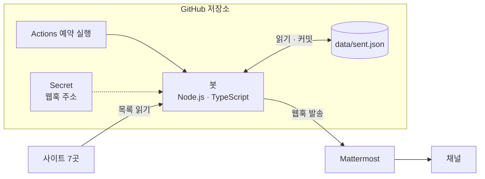
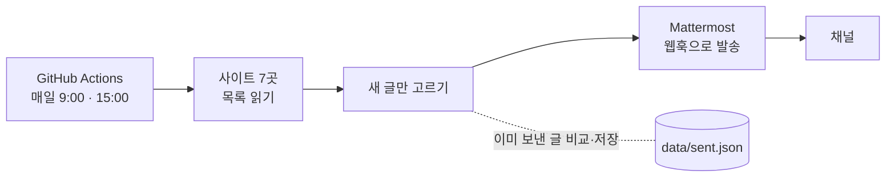

# jakdang

- 국내 개발 행사 소식을 Mattermost 채널로 보내 주는 알림 봇입니다.
- 공모전·경진대회·해커톤·컨퍼런스·세미나·외부 동아리 모집 글을 모읍니다. 새로 올라온 글만 골라 하루 두 번 알림을 보냅니다.

## 시스템 아키텍처



따로 띄운 서버나 DB가 없습니다. 봇은 GitHub Actions 안에서만 돌고, 보낸 목록은 저장소 안의 JSON 파일 하나에 둡니다.

## 흐름



### 사이트 7곳

- 위비티: 웹·모바일·IT 공모전
- DACON: AI·데이터 대회
- 올콘: 공모전 개발 분류
- 씽굿: 게임·소프트웨어 공모전
- OKKY: IT 행사(컨퍼런스·세미나·동아리)
- 씽유: IT·SW 공모전
- 콘테스트코리아: 학문·과학·IT 공모전

찾은 글은 걸러 내지 않고 다 보냅니다. 그래서 개발과 상관없는 행사가 섞일 수 있습니다.

목록 페이지만 읽습니다. 상세 페이지는 열지 않고, 로그인도 하지 않습니다. 봇이라는 것을 밝히는 User-Agent를 쓰고 robots.txt를 지킵니다.

## 알림 모양

```
## 현대자동차그룹 차량용 앱 개발 공모전
- 사이트: 위비티
- 링크: https://www.wevity.com/?c=find&s=1&gbn=view&ix=111802
```

글 하나에 행사 하나를 담습니다. 주최나 마감일은 넣지 않습니다.

## 알아 둘 점

- **첫 실행은 기억만 합니다.** 처음 보는 사이트는 지금 목록을 저장만 하고 아무것도 보내지 않습니다. 사이트를 새로 추가할 때도 똑같이 동작합니다.
- **중복은 사이트 안에서만 거릅니다.** 같은 공모전이 위비티와 씽유에 함께 올라오면 알림도 두 번 갑니다.
- **같은 글이 두 번 갈 때도 있습니다.** Mattermost에는 올라갔는데 응답이 끊기면, 봇은 실패로 보고 다음 회차에 다시 보냅니다. 알림을 놓치는 것보다 두 번 받는 쪽을 택했습니다.
- **사이트 하나가 고장 나도 나머지는 보냅니다.** 대신 그 회차는 실패로 끝나서 메일이 옵니다.

## 직접 돌리기

Node 24가 필요합니다(`.nvmrc`).

- `npm ci`: 의존성 설치
- `npm test`: 저장해 둔 실제 응답(fixture)으로 테스트
- `npm run check`: 실제 사이트 7곳을 읽어 보고 건수만 출력. 아무것도 보내지 않습니다
- `MATTERMOST_WEBHOOK_URL=... npm start`: 한 회차를 실제로 실행. 진짜 채널로 글이 가고 `data/sent.json`도 바뀝니다

## 파일

- `src/main.ts`: 실행 진입점
- `src/run.ts`: 사이트를 돌며 새 글을 골라 보내는 흐름
- `src/state.ts`: 보낸 목록(`data/sent.json`) 읽기·저장
- `src/mattermost.ts`: 알림 글 만들기와 웹훅 발송
- `src/http.ts`, `src/chain.ts`: 요청 도우미. 인증서 체인이 빠진 사이트는 실행 중에 보완합니다
- `src/sources/`: 사이트별 목록 읽기
- `.github/workflows/notify.yml`: 예약 실행
- `docs/superpowers/`: 설계 문서와 구현 계획
